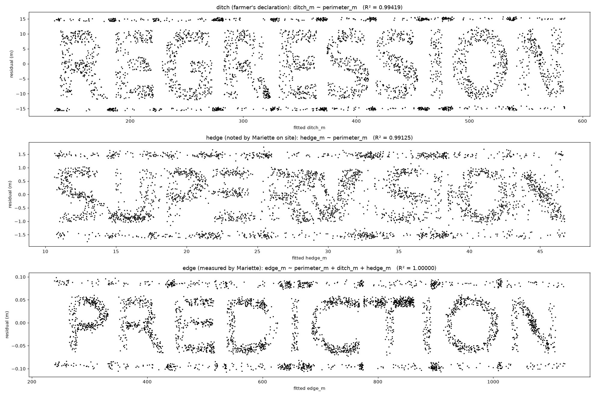

# Fry-ndship — Sigmoid (Belgium)

**Flag: `SIGMOID_<redacted>`**

Every length column in the survey is the field's rectangle perimeter `2(L + A/L)`
(long side `L`, area `A`) times a constant, plus a planted residual. Plotting each
fit's residuals against its fitted values spells a word:

| Column | Source | Model | Residual word |
|---|---|---|---|
| `ditch_m` | farmer's declaration | 0.50 × perimeter | REGRESSION |
| `hedge_m` | **noted by Mariette on site** | 0.04 × perimeter | **SUPERVISION** |
| `edge_m` | measured by Mariette | 0.41 × perimeter + ditch + hedge | PREDICTION |

That's why the analyst's model explains more than 99% of edge length: the words
hide in the leftover 1%. The word that belongs to Mariette's own observations,
her on-site hedge notes, is **SUPERVISION**.



## Run

```bash
pip install numpy pandas matplotlib
python solve.py task_belgium/potato_fields.csv
```
