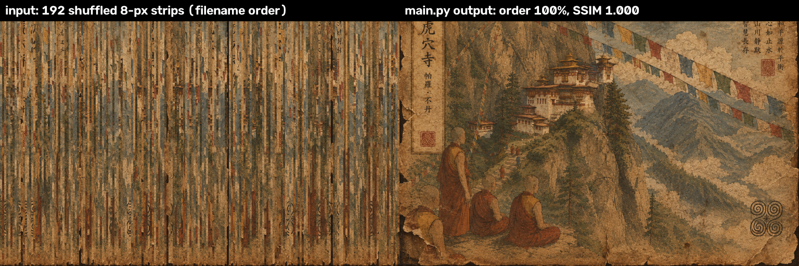

# The 300-Year Old Tiger Nest Painting: strip-shredding reassembly

This is a solution for the Sigmoid LMML 2026 Bhutan task. A scroll image has been cut into vertical strips of equal width and shuffled, and the strip filenames carry no information about position. `main.py` reads every PNG in `./input`. It writes `reconstructed_order.json` and `reconstructed_image.png` next to itself.



## Method

1. **Edge dissimilarity.** For every ordered pair (i, j), the script computes the cost of putting strip j directly to the right of strip i. Colours are first converted to Lab. The cost combines three terms:
   * the gradient-extrapolation ("prediction") error from both sides: `2*R1_i - R2_i` against `L1_j`, and `2*L1_j - L2_j` against `R1_i`;
   * the direct boundary difference `R1_i` against `L1_j`.

   Each term uses a robust square-root norm, summed over rows.
2. **Normalisation.** Each cost is divided by the second-best cost in its row or column, whichever is smaller. A strip with smooth edges is then no longer a "match for everything".
3. **Ordering.** The order is the shortest Hamiltonian path through these costs. A greedy chain merge (Kruskal-style) picks the cheapest links first and keeps every chain a simple path. Or-opt block moves then refine the path, under a time budget.

The whole run is O(n^2 * h) and needs no search. The 192 training strips take about 1 s, which is far under the 20 s limit.

## Validation (pinned env: Python 3.13, numpy 2.5.3, opencv-python 5.0.0.93, scipy 1.18.1, scikit-image 0.26.0)

`check.py` imitates the evaluator. It copies `main.py` into a fresh temporary directory with the strips under `input/`, runs it with a 20 s timeout, and scores the result against two thresholds: SSIM ≥ 0.90 and position-wise order match ≥ 0.90 (a mirrored order also counts).

| case | strips | order match | SSIM | time |
|---|---|---|---|---|
| train image | 192 x 8 px | 1.00 | 1.000 | ~1.0 s |
| 12 held-out synthetic shreds (random crops, flipped/rotated, widths 4–16 px, 55–313 strips) | | 1.00 each | 1.000 each | 0.4–1.6 s |

```
python check.py 12
```
