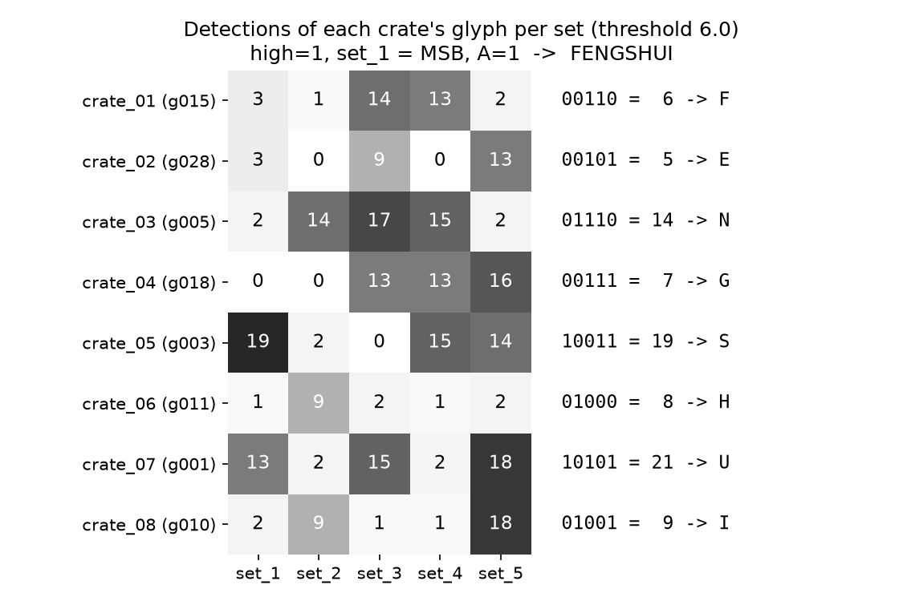

# Carved in bones, engraved in the heart: counting oracle-bone glyphs

This is a solution for the Sigmoid LMML 2026 China task. There are eight crates. Each crate has one glyph on its lid and holds five bundles (sets) of 30 unlabelled rubbings. *"Each crate keeps one letter. It is written in how often the crate's glyph was carved across its five sets."*



## Result

For every crate, the five per-set counts are clearly **bimodal**. In some sets the crate's glyph appears in roughly half the rubbings (9–19 detections out of 30 rubbings). In the others it appears only at the background rate (0–3). Reading each set as one bit (high = 1, low = 0), with set_1 as the most significant bit, gives a 5-bit number. That number is a 1-based alphabet index (A = 1):

| crate | glyph | set_1..set_5 counts | bits | letter |
|---|---|---|---|---|
| crate_01 | g015 賓 | 3 1 14 13 2 | 00110 = 6 | F |
| crate_02 | g028 今 | 3 0 9 0 13 | 00101 = 5 | E |
| crate_03 | g005 其 | 2 14 17 15 2 | 01110 = 14 | N |
| crate_04 | g018 㞢 | 0 0 13 13 16 | 00111 = 7 | G |
| crate_05 | g003 王 | 19 2 0 15 14 | 10011 = 19 | S |
| crate_06 | g011 不 | 1 9 2 1 2 | 01000 = 8 | H |
| crate_07 | g001 貞 | 13 2 15 2 18 | 10101 = 21 | U |
| crate_08 | g010 雨 | 2 9 1 1 18 | 01001 = 9 | I |

The word is **FENGSHUI** (風水).

How robust is this?
* The low counts never exceed 3 and the high counts are never below 9. The threshold is placed automatically in the biggest gap between the sorted counts, at 6.
* The same word comes out at every detector confidence threshold from 0.1 to 0.6 (columns `c10`…`c60` printed by `count_crates.py`).
* It also comes out from two different checkpoints: an early epoch-8 model and the epoch-29 best model.

## Method

1. **Detector.** `prepare_yolo.py` converts `train_labels.csv` (1,800 rubbings, 14,149 boxes) into a YOLO dataset. All 211 classes are kept, including `rare`, so the model learns to tell the crate glyphs apart from look-alike glyphs. 15% of the images are held out for validation. `train_yolo.py` fine-tunes YOLO11s at imgsz 896 on an RTX 3070 Ti. Held-out mAP50 over all 211 classes is about 0.43. The eight crate glyphs are among the most frequent classes, so they are detected much better than that average suggests.
2. **Counting.** `count_crates.py` runs the detector on each crate rubbing, one image at a time. Batching 30 images per call tripped Ultralytics' NMS time limit and silently dropped whole batches of detections. The script then counts the detections of the crate's own glyph per set at conf ≥ 0.25 and writes `counts.csv` (crate, set, glyph_id, count). Every detection of every class is also saved in `detections_crates.csv`.
3. **Decoding.** `decode.py` thresholds the counts, reads the bits, maps them to letters and draws `figure.png`.

For comparison, the shipped `baseline_solution.py` uses an averaged template with normalised cross-correlation. It produces counts of about 40–300 per set with no structure, so it cannot reveal the code.

```
python prepare_yolo.py --data data --out yolo
python train_yolo.py --yaml yolo/data.yaml          # GPU
python count_crates.py --weights best.pt --data data --out counts.csv
python decode.py counts.csv
```
