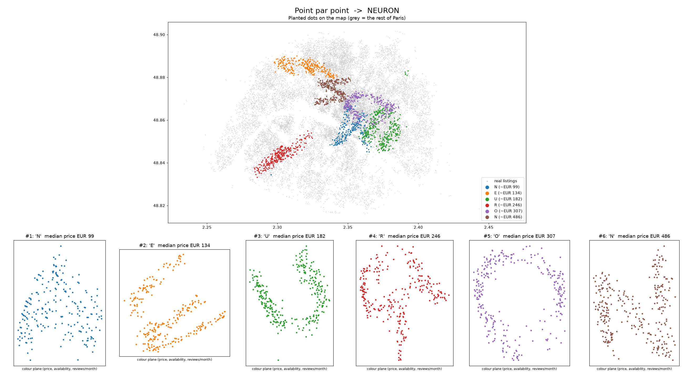

# Point par point — solution

**Flag: `SIGMOID_<redacted>`**



## The task

`paris_listings.csv` holds about 28,000 Paris accommodation listings. An artist slipped extra "dots" (rows) into it. The dots' colours come from what every traveller weighs before booking a night, and together the dots form letters. The goal is to separate those letters from the rest of the city, look at each one, and read the word in the artist's order.

## Solution in one paragraph

The planted rows look normal one column at a time. What gives them away is a **joint** structure. Within each letter, three traveller features, **price**, **availability_365** and **reviews_per_month**, change smoothly together, like a colour gradient over a painted shape. I scored every row by how crowded it is in the joint *(colour + location)* space, compared with the same count after shuffling colours across locations. The score histogram is bimodal, and its upper mode contains **1,765 planted dots**. Clustering those dots gives **6 letters**. Each letter's three colour values lie on a flat plane, and projecting a letter onto its plane shows the glyph. Read from the cheapest letter to the most expensive, they spell **N-E-U-R-O-N**.

## Method

### 1. What doesn't work

Simple checks find nothing:
- no out-of-range values
- no duplicated rows
- no inconsistencies (ratings always match review counts, last-12-month reviews never exceed the total)
- nothing from Isolation Forest, LOF, or PCA/t-SNE on all features

Plotted in plain grey, the planted dots disappear among the real listings, which fits the caption: *"Grey is pretty. It holds multiple secrets."*

### 2. Detecting the planted dots — `solve.py`, step 1

For each row I build a 5-D vector:

| component | scaling |
|---|---|
| log(price) | / 0.12 |
| availability_365 | / 25 |
| log(reviews_per_month) | / 0.15 |
| latitude (km) | / 0.6 |
| longitude (km) | / 0.6 |

Then:
- **observed** = number of neighbours within radius 1 in this space
- **expected** = average neighbour count after randomly permuting the colour part across locations (10 permutations), so location density is kept but any link between colour and place is broken
- **score** = (observed + 1) / (expected + 1)

Real listings score about 1. The planted dots score 6–25, because each letter is a thin, coherent sheet in colour + space. `log2(score)` is bimodal, with a valley near 4.5. Using that threshold selects **1,765 dots**.

### 3. Separating the letters — step 2

- HDBSCAN (`min_cluster_size=40`) in the same joint space, applied to the planted dots only, finds 7 clusters.
- The single-linkage gap between two of them is **1.26**, while every other pair is at least **4.3** apart. Those two touching pieces belong to one letter, so I merge them (gap < 2).
- That leaves **6 letters of 238–337 dots each**.

### 4. Looking at each letter — step 3

On the map, each letter is blurred by the ±150 m privacy shift. Its colours are not: within a letter, the three standardised colour values (log price, availability, log reviews/month) lie almost exactly on a **2-D plane** (the third principal component explains only about 1–2 % of the variance). So for each letter I:

1. project its dots onto that plane (PCA, dropping the few dots that sit off the plane),
2. whiten the result (equal spread in both directions), which removes the stretch introduced by the linear colour encoding,
3. rotate or mirror it so the glyph stands upright.

The last step is for display only. PCA axes have no built-in "up", so each letter's orientation (one of 4 rotations × mirror) was chosen by eye and fixed in `DISPLAY_ORIENT` in `solve.py`. It turns the picture; it does not change which dots belong to which letter.

| # | letter | dots | median price | median availability | median reviews/month |
|---|---|---|---|---|---|
| 1 | **N** | 238 | €99 | 24 | 0.31 |
| 2 | **E** | 283 | €134 | 295 | 1.00 |
| 3 | **U** | 337 | €183 | 336 | 1.72 |
| 4 | **R** | 286 | €246 | 162 | 1.16 |
| 5 | **O** | 306 | €307 | 253 | 0.44 |
| 6 | **N** | 312 | €486 | 56 | 3.38 |

U, O and the second N are the clearest shapes. E and R read well. The first N is the noisiest glyph.

### 5. The artist's order — step 4

The letters sit at clearly separated **price levels**, the strongest colour channel. Reading them from cheapest to most expensive gives **NEURON**, a fitting word for a contest named after the sigmoid activation function.

## Files

| file | content |
|---|---|
| `solve.py` | full, deterministic pipeline (seed 0); prints the word and writes the two outputs below |
| `labels.csv` | one row per listing: `listing_id`, `planted` (0/1), `letter_idx` (position in the word, −1 = real listing), `letter`, `score` |
| `pointillism_solution.png` | top: planted dots coloured by letter over the grey city; bottom: each letter in its colour plane, in reading order |

## Reproduce

```bash
pip install pandas numpy scipy scikit-learn matplotlib
# put the task's paris_listings.csv next to solve.py
python solve.py
```

Expected output ends with `WORD: NEURON ->  FLAG: SIGMOID_<redacted>`. The dataset itself is not included in this repo. Use the CSV provided with the task.
