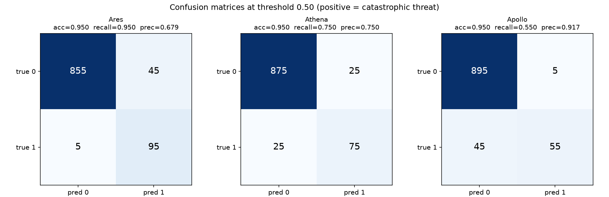

# Greece — "Just a siblings' thing"

**Flag: `SIGMOID_<redacted>`**

## Setup
- `data/model.py` defines `MythicThreatClassifier`: a single `nn.Linear(9, 1)` that outputs a logit. It reads the 9 numeric columns in `FEATURE_COLUMNS` order, using the raw values as they are.
  `region` and `moon_phase` are **not** model inputs, so no encoding or scaling is needed.
- The checkpoints are untrusted, so they are loaded with `torch.load(..., weights_only=True)`.
- Prediction = `sigmoid(logit) >= 0.50`. Positive class = catastrophic threat (100 of the 1000 test rows).
- Check on the preprocessing: all three models score exactly 0.95 accuracy, which matches the task statement.

## Results (threshold 0.50)

| Model  | Accuracy | Precision | Recall | F1    | F2    | ROC-AUC | TN  | FP | FN | TP |
|--------|---------:|----------:|-------:|------:|------:|--------:|----:|---:|---:|---:|
| Ares   | 0.950 | 0.679 | **0.950** | **0.792** | **0.880** | **0.947** | 855 | 45 | **5**  | 95 |
| Athena | 0.950 | 0.750 | 0.750 | 0.750 | 0.750 | 0.877 | 875 | 25 | 25 | 75 |
| Apollo | 0.950 | **0.917** | 0.550 | 0.688 | 0.598 | 0.786 | 895 | 5  | 45 | 55 |



## Choice
Accuracy is the same for all three. They differ in how their 50 errors divide between false alarms and missed threats:
- **Ares** misses only 5 of 100 real threats (recall 0.95). The cost is 45 false alarms.
- **Athena** misses 25 (recall 0.75).
- **Apollo** misses 45 (recall 0.55). It is the most precise model, but it lets almost half of the catastrophes through.

A missed threat costs far more than a false alarm, so recall on the positive class is the metric that matters, and Ares has the highest.
Ares does not get that recall by predicting everything as positive: it flags 140 of 1000 encounters and keeps precision at 0.68.
Ares also comes first on F2, which weights recall above precision, on F1 and on ROC-AUC, which does not depend on the threshold. Every metric suited to this deployment points to the same model.

→ **Ares guards Delphi. Flag: `SIGMOID_<redacted>`.**

## Reproduce
```
pip install torch numpy pandas scikit-learn matplotlib
python evaluate.py --data data --out .
```
The script writes `metrics.csv`, `metrics.md` and `confusion_matrices.png`.
These results were produced on the GPU machine with torch 2.15.0 under Python 3.14.
The pinned torch 2.6.0 has no Python 3.14 wheel; the full environment is in `pip_freeze.txt`. The model is one linear layer, so the torch version does not change the output.
