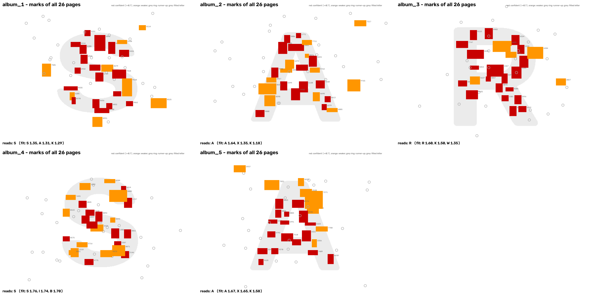

# Stamp of Disapproval: automatic localisation of altered stamp regions

Each album page holds three stamps, and on every page one small region of one stamp was altered
(a digit changed, an element cloned, or an inscription removed). `detect.py` finds that region on
every page by itself. The 26 marks of one album, drawn on one sheet, form a letter. The five
letters, in album order, read **S A R S A**.



## Method: the altered region has lost the stamp's own JPEG history

Before forensics, I checked what the data looks like:

* Pages are JPEG with the luminance table `1 1 1 1 1 2 3 4 ...`, which is IJG quality 97.
* Inside each stamp there is a second, weaker 8x8 blocking lattice. It sits at a stamp-specific
  offset that is generally not aligned with the page grid. A JPEG-ghost scan over 64 offsets
  and qualities 40-95 shows a clear dip for most stamps at quality ~80-92. So every stamp image
  was JPEG-compressed once on its own and then pasted onto the page at an arbitrary position.
* On the exhibits, the region inside the mask does **not** show that ghost: the alteration was
  made after the stamp's own compression.
* Simple residual cues (noise level, Laplacian, chroma residual, error-level analysis) are not
  consistent on the exhibits (mask rank anywhere between 0 and 1).
* Dense copy-move matching finds no near-identical pixel copies for the "changed digit"
  exhibits (best match RMS > 4 grey levels, the same as natural repeats). So cloning in the
  pixel sense is not a usable trace here.

The detector is therefore a non-aligned double-JPEG test (`detect.py`, numpy + OpenCV only):

1. **Stamp mask:** everything that is not the dark album background (morphological close,
   holes filled). Blocks touching a stamp edge are dropped.
2. **Grid hypotheses:** the 8x8 block DCT of the luminance for all 64 grid offsets. For each
   offset and IJG quality in 60..96, a per-block log-likelihood ratio
   `LLR = sum_k [log N(d_k; 0, s) - log U(-Q_k/2, Q_k/2)]`, where `d_k = c_k - Q_k round(c_k/Q_k)`,
   over informative AC coefficients (`|c_k| > 0.35 Q_k`). Each block takes the hypothesis with
   the largest LLR sum over its 21x21-block neighbourhood. The page's own grid (offset 0,0 at
   quality >= 93) is excluded. This also separates the three stamps of a page, and sub-stamps of
   souvenir sheets, by their grids.
3. **Data-driven quantiser:** for every region that shares a grid, the step `Q_k` and the
   residual sigma `s_k` of each of the 63 AC coefficients are re-estimated from the data, with
   the IJG table only as a start. Coefficients that do not fit a lattice are switched off. The
   per-block LLR is then recomputed with these tables.
4. **Simulated null (calibration):** the region's blocks are snapped onto the estimated lattice,
   the page is re-encoded at quality 97, and the LLR is measured again. Blocks that look
   "non-compressed" only because of clipping at 0/255 or strong edges look the same in the
   simulation, while genuinely edited blocks do not. Anomaly per block = `max(LLR_sim - LLR_obs, 0)`,
   summed over 3x3 blocks.
5. **Decision:** the strongest local maximum inside a stamp is the altered region. Its box is the
   connected set of blocks above 35 % of the peak, at most about 130 px across.
   Confidence = `peak / (peak + best other peak at least ~100 px away)`.
6. **Letter reading (after detection, independent of it):** every capital A-Z (thick Hershey
   simplex) is fitted to the 26 marks over box size, aspect and position. The score is the
   chance-corrected fraction of marks on the letter body plus the fraction of the letter body
   that has a mark nearby. Marks with confidence >= 0.7 weigh 1.0, the others 0.3.

The letter layout is never used to choose a page's mark. Each page is scored on its own pixels.

## Validation on the 30 exhibits

Run with `--validate`. A hit means the predicted centre is within 8 px of the mask
(`exhibit_validation.csv`).

| variant | top-1 hit | top-3 hit |
|---|---|---|
| per-stamp grid, fixed IJG table, plain LLR | 66.7 % | - |
| + per-coefficient Q/sigma estimation, local grid selection | 86.7 % | 96.7 % |
| + simulated-null calibration (final) | **90.0 %** | 93.3 % |

Mean IoU of the final box with the mask rectangle is 0.37. The boxes are block-quantised and
somewhat generous, and the exhibit masks are tight rectangles.

Misses: exhibits 01 and 28 are inscriptions removed from flat, fully saturated white paper.
There every pixel is clipped at 255, so no JPEG lattice is measurable inside or outside the
mask. Exhibit 16 is low-texture. Including the DC coefficient did not change the result
(90.0 %), so it is left out.

## Album sheets

Sheets are in `figures/sheet_album_N.png`. Filled boxes show the detected region of each page:
red when confidence >= 0.7, orange when weaker. Grey rings are each page's runner-up
candidate. The light grey shape is the best-fitting letter.

| album | letter | fit score (best / 2nd / 3rd) | confident pages | marks on fitted letter |
|---|---|---|---|---|
LETTER_TABLE

Notes per album:

* **album_1, S:** a clear S with top arc, upper-left, diagonal middle, lower-right, bottom arc
  and lower-left tail. The reader's margin over A/K is small (1.35 vs 1.31) because S has little
  stroke area. Visually S is unambiguous, and B is excluded by the empty left side between the
  two bowls.
* **album_2, A:** a clear A, the largest margin of all albums. Two marks (pages 7217, 9765) lie
  off the letter.
* **album_3, R:** stem, bowl and diagonal leg are all present. K is second (1.50) but has no top
  bar or bowl.
* **album_4, S:** the weakest album, with only 14 of 26 pages confident. In an early, uncalibrated
  run I briefly considered M or X. With all marks shown, the S's terminals (upper-right,
  lower-left) and the middle diagonal are populated, and the reader prefers S over I and B.
* **album_5, A:** a clear A apex and both legs. X is second (1.65 vs 1.67) because the crossbar
  marks sit low, but the apex shape decides.

Per-page overlays (page scaled to 50 %, red = detected region, yellow = runner-ups) are in
`figures/pages/`.

## Per-page confidence

PAGE_TABLE

## Files

* `detect.py`: the whole pipeline (detection, boxes, sheets, letter reading, exhibit validation).
* `boxes.csv`: `album,page,x,y,w,h`, one box per page (page pixel coordinates).
* `candidates.csv`: top-3 candidates per page with score and the page confidence.
* `letters.json`: letter per album, fit scores, the fitted letter box, and the pages whose mark
  is off the letter.
* `exhibit_validation.csv`: per-exhibit hit / IoU / confidence.
* `figures/`: the five album sheets, the combined sheet, and per-page overlays.

## Reproduce

```
uv venv -p 3.11 .venv && uv pip install -p .venv numpy==2.2.6 opencv-python==5.0.0.93
.venv/bin/python detect.py --data data --out . --validate
```

The dataset is not included. Put `albums/` and `exhibits/` under `data/`. A full run takes about
45-60 min on 4 CPU threads (about 20 s per page) and needs under 1 GB of RAM. It was checked
end-to-end with exactly the pinned numpy 2.2.6 and opencv-python 5.0.0.93 on Python 3.11.
