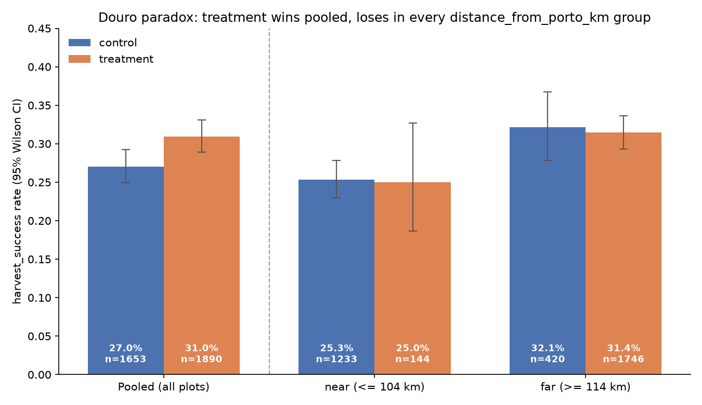

# Portugal: The Douro Paradox

**Flag:** `SIGMOID_<redacted>`

Reproduce with `python -I solve.py` (needs pandas, numpy, matplotlib). It prints every number below and writes `douro_paradox.png`.

## 1. Overall: treatment looks better

| Arm | Successes / plots | harvest_success rate (95% Wilson CI) |
|---|---|---|
| control (old method) | 447 / 1653 | **27.04%** (25.0 to 29.2%) |
| treatment (new drip irrigation) | 585 / 1890 | **30.95%** (28.9 to 33.1%) |

Pooled, treatment is **3.9 percentage points ahead**.

## 2. The splitting column: `distance_from_porto_km`

The distance distribution has two separate clusters with an empty band between them. No plot lies between **104.0 km and 114.0 km**. That 10 km gap is the largest in the column; the next largest gap is 0.3 km. So the data falls naturally into two groups:

- **near**: distance ≤ 104 km (1,377 plots)
- **far**: distance ≥ 114 km (2,166 plots)

## 3. Within every group: control is ahead

| Group | Control | Treatment | Treatment − control | Share of plots on treatment |
|---|---|---|---|---|
| near (≤ 104 km) | 312 / 1233 = **25.30%** | 36 / 144 = **25.00%** | −0.30 pp | 10.5% |
| far (≥ 114 km) | 135 / 420 = **32.14%** | 549 / 1746 = **31.44%** | −0.70 pp | 80.6% |

Control does better than treatment in **both** groups. Weighting the two groups by size gives a treatment effect of **−0.55 pp**, against **+3.91 pp** when the data is pooled.

## 4. Why pooling reverses it

The new method went mostly to the far plots (81% of far plots are on treatment, against 10% of near plots), and far plots succeed more often whatever method they use (about 32% against 25%). Pooling therefore credits treatment with the advantage of its location, even though it is slightly worse than the old method within each location.

## 5. Checks: the other columns fail

`solve.py` searches every column for any split that puts control ahead in all groups, requiring at least 30 plots per arm in each group. For categorical columns it tries the natural levels and every two-way partition of the levels. For numeric columns it tries 2/3/4/5/10-quantile bins and every possible single threshold.

- **distance_from_porto_km** is the only column with a complete reversal. The reversal appears only when the threshold falls in or just below the empty 104 to 114 km band (thresholds from 103 to 114 km). Any cut that cuts through either cluster fails. Quantile bins give only a partial reversal (for example, 3 of 5 quintiles).
- **cooperative**: control is ahead in only 3 of 12 co-ops (COOP-03, 04, 07). No two-way grouping of co-ops reverses in both parts.
- **slope_aspect**: control is ahead only on west-facing plots (−2.2 pp). Treatment is ahead on north, south and east.
- **soil_depth_cm** is also clearly bimodal (gap from 70 to 110 cm), but treatment is spread evenly across its two clusters (52% and 55% treatment). Splitting at that gap leaves treatment ahead in both groups (+2.1 pp and +5.9 pp).
- **soil_ph, vine_density_per_ha, elevation_m, annual_rainfall_mm, sun_hours_july**: some fine bins turn negative, but no grouping is negative throughout.
- **trellis_system, vineyard_age_group, grape_variety, organic_certified, harvest_month**: treatment is ahead in every level.

Distance is also the only covariate strongly linked to treatment assignment (correlation with treatment = 0.58; all others |r| < 0.03), which is what a Simpson reversal needs.

## Caveat

The gaps inside each group are small (−0.3 pp and −0.7 pp), and the per-group 95% confidence intervals overlap heavily. The data supports "the pooled advantage of the new method comes entirely from where it was deployed", not "the new method is significantly worse". Even so, the direction reverses in every group, which is what the task asks for.
