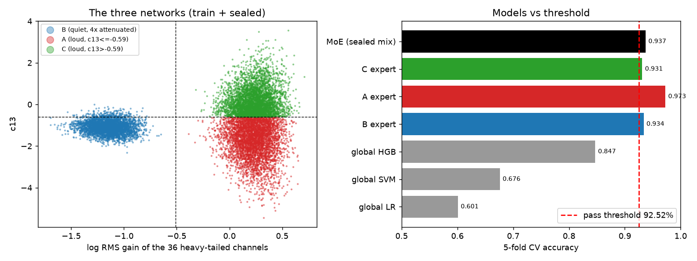

# Romania: "Shaken, Still Standing" (Hard)

**Flag: `SIGMOID_<redacted>`**. This is the exact output of `evaluation_script.py predictions.csv`.

## The idea in one line
The story says *"Three networks send you their records"*. The data really is a mix of three networks, and each one uses a different rule for "Vrancea or not". No single model can learn all three rules, so I route each record to its network and fit one expert per network. This is a mixture of experts.

## What the evaluator needs
`vault.npz` holds a Reed–Solomon (Gao) decoder over GF(65521) with n = 5000 and k = 4252. The flag only decodes when at least (n+k)/2 = 4626 of the 5000 sealed records are right, so **sealed accuracy must be at least 92.52%**. The decoded 11-byte word is checked against a sha256 tag. That means a word that decodes is the real flag, not a decoy.

## Finding the three networks (the routing uses no labels)
1. **Two kinds of channels.** 12 channels (c03 c09 c12 c14 c15 c19 c27 c28 c30 c36 c39 c40) are plain Gaussians, with excess kurtosis near 0. The other 36 have excess kurtosis near 0.9, which is what a *scale mixture* produces.
2. **Gain.** The RMS of the 36 heavy-tailed channels around their median has two clear modes, at about 0.31 and about 1.2. That is a factor of 4. The quiet group (**B**, 1900 train / 2000 sealed) is a network whose 36 channels are attenuated about 4×. A 2-component GMM finds the same split (BIC drops from 1.71M to 1.51M).
3. **c13.** In the loud records, the density of c13 jumps sharply at -0.6. Below the jump, the labels follow a parity rule (**A**, 3698 / 600). Above it, they follow a linear rule (**C**, 1902 / 2400).
4. Within each network, every channel is an independent Gaussian (all correlation eigenvalues are about 1). So the label rules carry the only structure.

**Covariate shift:** train is 25/49/25% B/A/C, but sealed is 40/12/48%. The easy parity network makes up half of train but only 12% of sealed. So a model's overall CV accuracy on train overstates how it will do on sealed. The estimates below are therefore weighted by the sealed network mix.

## The rule in each network, and the models tried (5-fold CV inside the network)
| Network | What the rule looks like | Models tried (CV accuracy) | Expert used |
|---|---|---|---|
| **B** quiet (sealed 2000) | Ellipsoidal "energy" boundary in the 12 Gaussian channels: y correlates with x² (r≈0.2) and has real cross-terms | quadratic LR on 12 ch 0.926 · RBF-SVM 0.915–0.917 · QDA 0.895–0.898 · LR + squares 0.880 · MLP 0.852 · HGB 0.832 · RF 0.802 · linear LR 0.583 · all 48 channels: HGB 0.827, LR 0.589 | **Soft vote of quad-LR + RBF-SVM + QDA: 0.932–0.934** |
| **A** loud, c13 ≤ -0.59 (sealed 600) | `y = 1 XOR [c43>-0.615] XOR [c35>-0.225] XOR [c38>0.73]`; the closed form scores 0.974 | RF on (c35,c43,c38) 0.973 · HGB on all 48 channels 0.970–0.972 · HGB on the 3 channels 0.966 · MLP 0.938 · RBF-SVM 0.908 · ExtraTrees 0.902 · quad-LR 0.763 · LR 0.56 | **RF on the 3 parity channels: 0.973** |
| **C** loud, c13 > -0.59 (sealed 2400) | Dense linear boundary (largest weights: c12, c30, c01, c47, c41, c19, …) | LR C=1 0.931–0.933 · LR C=0.3 0.931 · linear SVM 0.925 · LR + squares 0.927 · RBF-SVM 0.902–0.905 · MLP 0.892 · QDA 0.830 · HGB 0.822 · RF 0.818 | **Logistic regression: 0.931** |

The global single models from the baseline do much worse: LR 0.601, RBF-SVM 0.676, MLP 0.656, kNN 0.528, RF 0.768, HGB 0.847.

**How the models are combined.** A hard gate, made without labels, sends each record to its network. Inside network B, three models are combined by averaging their probabilities (soft voting), which adds about 0.8 points over the best single model there. Networks A and C each use a single model, because averaging their candidates did not help: the A ensemble scored 0.972 and the C ensemble 0.930.

**Expected sealed accuracy:** 0.934·0.40 + 0.973·0.12 + 0.931·0.48 ≈ **0.937**, which is about 60 records above the threshold.

## What didn't work
- Any single global model. It has to learn three unrelated rules at once.
- Rescaling the gain away and then fitting one model. That does not help, because the rules differ between networks, not only the scales.
- Self-training on confident sealed pseudo-labels in each network. The change was within ±0.1 point (for example C: 0.931 to 0.932, B ensemble 0.932 to 0.932), so I left it out.
- In network B, using all 48 channels instead of the 12 Gaussian ones. The extra channels are noise there.
- Looking for patterns in record_id (mod-k label rates, correlation with the label). Nothing found.

Errors at high margin are about 1–3% in every network, so the remaining errors are mostly label noise. The parity network reaches 97.4% with the exact rule.

## Reproduce
```
python solve.py            # expects ./data/{dataset/*.csv, dataset/vault.npz, evaluation_script.py}
```
It needs numpy, pandas, scipy, scikit-learn and matplotlib, and was tested with Python 3.14 and scikit-learn 1.9. It routes the records, prints the per-model CV scores, writes `predictions.csv` and `figure_networks_and_scores.png`, and runs the evaluator, which prints `SIGMOID_<redacted>`. It takes about a minute on a laptop.

The exploration and sweep scripts are in `work/`. The sweeps were run on the GPU box, with logs in `~/sigmoid_romania/a1/`.


