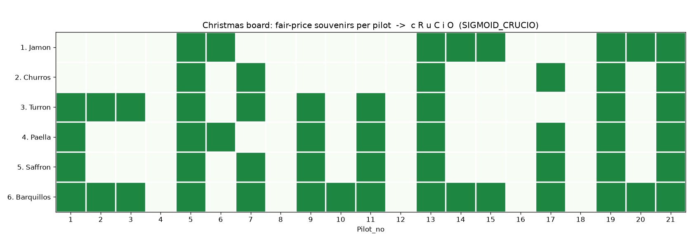

# ¡Feliz Navidad! — Sigmoid (Spain)

**Flag: `SIGMOID_<redacted>`**

1. Price per unit = `Total_paid_eur / Quantity`.
2. Office rule: keep a receipt only if `Fair_min_eur <= price per unit <= Fair_max_eur`
   (cheaper = fake, dearer = tourist trap). 77 of 577 receipts survive.
3. Board: one column per pilot (`Pilot_no` 1–21), one row per list item
   (`List_no` 1–6, top to bottom). A cell is filled if that pilot brought that
   souvenir at a fair price.

The board reads **c R u C i O**, so the word is **CRUCIO**.



```
....##......###...###
....#.#.....#...#.#.#
###.#.#.#.#.#.....#.#
#...##..#.#.#...#.#.#
#...#.#.#.#.#...#.#.#
###.#.#.###.###.#.###
```

## Run

```bash
pip install numpy pandas matplotlib
python solve.py task_spain
```
