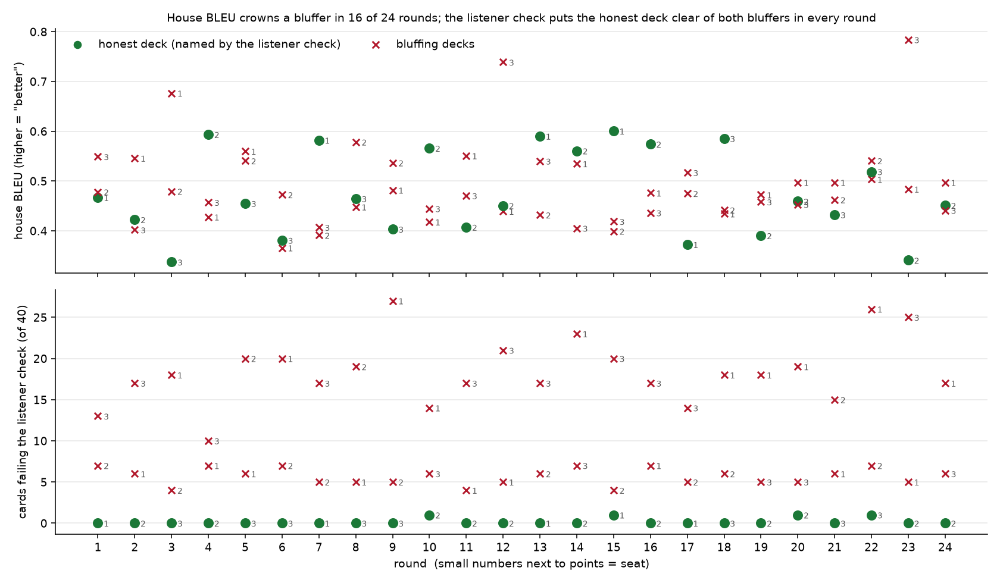

# United Kingdom: Call My BLEUff

**Flag: `SIGMOID_<redacted>`**

The honest seats, rounds 1 to 24, are `1 2 3 | 2 3 3 | 1 3 3 | 2 2 2 | 1 2 1 | 2 1 3 | 2 2 3 | 3 2 2`. As base-3 digits that is `012 122 022 111 010 102 112 211`, which gives 5 17 8 13 3 11 14 22 and spells **F R I N D L O W**.

The producers crowned the highest house BLEU in each round, which spells `SKELDRAP`. BLEU picks a bluffer in 16 of the 24 rounds.

Files

| file | what it is |
|---|---|
| `solve.py` | The whole solution. Pure-Python stdlib; matplotlib is used only for the figure. `python -I solve.py` prints the per-round table, the breakdown of failures by check, the word and the flag. `--figure` also writes `separation.png`. `--sensitivity` reruns the decision under other thresholds. |
| `separation.png` | The figure. BLEU per deck is on top; cards failing the listener check per deck are underneath. |
| `validate_e2e.py` | An independent cross-check that `solve.py` does not use. It traces every description back to the public E2E NLG corpus (see the Validation section). |
| `work/` | Exploration scripts and intermediate files, including the GPU run that scored language-model fluency. |
| `data/` | The task's files, unchanged. |

---

## 1. What the house scorer rewards

From `data/bleu.py`:

* **Precision only.** It counts output n-grams (orders 1 to 4) that appear in the references. Nothing measures whether the output *says* what the references say.
* **Clipping uses the maximum over references, one n-gram at a time.** Each n-gram is credited up to its count in whichever single reference has it most. Text built from several references can therefore collect n-grams from all of them.
* **The brevity penalty is pooled over the whole deck.** It is computed once from the summed output length against the summed *closest* reference length, with ties going to the shorter reference. A very short card is matched against the shortest reference, and any length shortfall can be paid for by padding other cards.
* **No smoothing; lower-cased; punctuation counts as tokens.** At corpus level these hardly matter. Every precision is far from zero, so smoothing never comes into play.

A listener would notice exactly what BLEU cannot see: facts that are missing, facts stated twice, text lifted from the guide, and sentences that stop halfway.

## 2. The gaming mechanisms

Each round has one **heavy** bluffer, who edits 13 to 32 of their 40 cards, and one **light** bluffer, who edits only 4 to 7. The counts come from the provenance check in the Validation section. There are three heavy styles, each used in 8 rounds, and one light style. All of the examples below come from the panel.

### (a) Cut-and-copy: copy a reference, then truncate it
Heavy bluffer in rounds 7, 8, 9, 15, 17, 19, 20 and 24.

| card | text |
|---|---|
| r9 c2, seat 1 | *There is a children friendly coffee shop in the riverside area called The Cambridge Blue. It has a customer rating of 3 out.* |
| reference 4 | *There is a children friendly coffee shop in the riverside area called The Cambridge Blue. It has a customer rating of 3 out of 5 and is located near to Burger King.* |
| r19 c26, seat 1 | *Located near The Bakers is a child.* |
| r9 c1, seat 1 | *In the riverside area, you can find The Olive Grove. This pub.* |

Every n-gram is a reference n-gram, so precision is close to 1. Seat 1 in round 9 has p4 = 0.48 against 0.20 to 0.32 for the other seats. The pooled brevity penalty (0.74) is the only cost.

### (b) Pad-and-glue: append a second description of the same facts
Heavy bluffer in rounds 5, 11, 12, 13, 14, 18, 22 and 23.

| card | text |
|---|---|
| r12 c1, seat 3 | *Riverside coffee shop is a 3 out of 5 kids friendly, with moder price ranges. Fitzbillies is a mid range coffee shop for fast food, it is family friendly and it is nearby the river.* (references 4 and 1, verbatim and glued together) |
| r14 c24, seat 1 | *The pub located near Café Rouge known as The Plough is kids friendly, they serve French food with a price range of £20-£25. The Plough is a French pub located near Café Rouge.* |
| r22 c17, seat 1 | *Located near Yippee Noodle Bar, Alimentum is an inexpensive, one star British restaurant. Located just outside the city centre, next to the River, Alimentum is a typically British breakfast pub.* |

Because clipping is per n-gram against the best single reference, gluing two references together keeps precision at the level of one reference copy while collecting twice the matches. The extra length also covers the deck's brevity penalty. These decks post the biggest BLEU scores of the whole show: round 12 seat 3 scores **0.739** and round 23 seat 3 scores **0.784**. The honest decks in those rounds score 0.451 and 0.341.

### (c) Word salad: splice reference n-grams into an ungrammatical string
Heavy bluffer in rounds 1, 2, 3, 4, 6, 10, 16 and 21.

| card | text |
|---|---|
| r1 c3, seat 3 | *With a High price range,The and offers gourmet burgers and freshly good meal deals.* |
| r2 c1, seat 3 | *With prices ranging near Raja Indian Cuisine by riverside. You can eat is kid-friendly and serves Japanese fare. price, and children are welcome.* |
| r21 c3, seat 2 | *There is a expensive restaurant that received Phoenix and has a poor located in Cambridge.* |

Local n-grams survive the shuffle, but the venue's facts, and often its name, drop out. Round 3 seat 1 is the BLEU winner of its round at **0.676**.

### (d) Light bluffing: quietly drop the facts that might not match
Every round has one light bluffer, and most of their edits cut a real description at a sentence boundary.

| card | text |
|---|---|
| r5 c13, seat 1 | *Near Ranch is The Cricketers.* |
| r9 c3, seat 2 | *The Plough is a family friendly pub located right next to Café Rouge.* (the dropped sentence is *It is in the mid level price range.*) |
| r19 c4, seat 3 | *Taste of Cambridge is located on the riverside near the Crown Plaza Hotel.* (the dropped sentence is *This coffee shop is kid friendly and serves English cuisine.*) |

The result is grammatical and fluent, and wrong only by omission. It raises precision, and the closest-reference rule matches each short card against the shortest reference, so it costs almost nothing in brevity penalty.

## 3. The proposed check: a "listener check"

`listener_check(text, references)` in `solve.py` runs on each card. The check uses no learned model and no external data. A description **fails** if any of the following holds:

| check | rule | what it catches |
|---|---|---|
| **OMIT** | At least 2 of the card's facts are not conveyed. The card's facts are the attributes (venue type, food, price, rating, area, family-friendliness) and the named venues (the venue itself and its landmark) that at least half of the 5 references mention. Facts are detected with small lexicons, for example `pric\|cost\|cheap\|expensive\|£…` for price. | (a), (c), (d) |
| **REPEAT** | At least 2 of those attributes are stated in two separate sentences. | (b) |
| **COPY** | At least 90% of the description is one contiguous token run from a single reference. | (a) |
| **TRUNC** | The description ends on a word that cannot end a sentence (*a, the, of, out, with, customer, …*) or stops inside a venue name (*… near Raja.*). | (a), (c) |

A deck's score is the number of failing cards, from 0 to 40. **The honest panellist is the deck with the fewest failures.** The margin is the gap to the next deck.

The design follows directly from section 1. BLEU measures precision against the references, so the check measures what precision leaves out:

* **recall of facts** (OMIT),
* **economy**, meaning no fact paid for twice (REPEAT),
* **originality** (COPY),
* **completeness of the sentence** (TRUNC).

## 4. Separation, round by round

Output of `python -I solve.py`:

```
round  seat1 seat2 seat3  honest margin    |  house BLEU  seat1 seat2 seat3  BLEU pick
    1      0     7    13  seat 1     7     |  0.467 0.478 0.549  seat 3
    2      6     0    17  seat 2     6     |  0.546 0.422 0.402  seat 1
    3     18     4     0  seat 3     4     |  0.676 0.479 0.337  seat 1
    4      7     0    10  seat 2     7     |  0.428 0.593 0.457  seat 2
    5      6    20     0  seat 3     6     |  0.560 0.541 0.455  seat 1
    6     20     7     0  seat 3     7     |  0.366 0.472 0.381  seat 2
    7      0     5    17  seat 1     5     |  0.582 0.391 0.407  seat 1
    8      5    19     0  seat 3     5     |  0.448 0.578 0.465  seat 2
    9     27     5     0  seat 3     5     |  0.482 0.537 0.403  seat 2
   10     14     1     6  seat 2     5     |  0.418 0.566 0.444  seat 2
   11      4     0    17  seat 2     4     |  0.551 0.407 0.470  seat 1
   12      5     0    21  seat 2     5     |  0.439 0.451 0.739  seat 3
   13      0     6    17  seat 1     6     |  0.590 0.432 0.540  seat 1
   14     23     0     7  seat 2     7     |  0.535 0.561 0.405  seat 2
   15      1     4    20  seat 1     3     |  0.600 0.399 0.419  seat 1
   16      7     0    17  seat 2     7     |  0.476 0.574 0.436  seat 2
   17      0     5    14  seat 1     5     |  0.372 0.475 0.517  seat 3
   18     18     6     0  seat 3     6     |  0.434 0.442 0.585  seat 3
   19     18     0     5  seat 2     5     |  0.472 0.390 0.458  seat 1
   20     19     1     5  seat 2     4     |  0.497 0.459 0.453  seat 1
   21      6    15     0  seat 3     6     |  0.497 0.462 0.432  seat 1
   22     26     7     1  seat 3     6     |  0.503 0.541 0.519  seat 2
   23      5     0    25  seat 2     5     |  0.484 0.341 0.784  seat 3
   24     17     0     6  seat 2     6     |  0.497 0.451 0.441  seat 1
```

* **The honest deck fails 0 cards in 20 rounds and 1 card in 4 rounds** (10, 15, 20, 22).
* **Bluffing decks fail between 4 and 27 cards.**
* **The margin is at least 3 in every round.** It is 4 or more in 23 rounds; the closest call is round 15, which scores 1 against 4.
* The script also prints which check fires in each deck. The three heavy styles show up as OMIT with TRUNC (salad), COPY with OMIT and TRUNC (cut-and-copy), and REPEAT (glue). The light bluffers are mostly OMIT.



*Top: house BLEU per deck. The honest deck (green) is often the lowest, and the glue and salad decks top the table. Bottom: cards failing the listener check. The honest deck sits at 0 or 1 in every round, and both bluffers sit at 4 or more.*

## 5. Decoding

| rounds | honest seats | digits | 9·d1 + 3·d2 + d3 | letter |
|---|---|---|---|---|
| 1–3 | 1 2 3 | 0 1 2 | 5 | F |
| 4–6 | 2 3 3 | 1 2 2 | 17 | R |
| 7–9 | 1 3 3 | 0 2 2 | 8 | I |
| 10–12 | 2 2 2 | 1 1 1 | 13 | N |
| 13–15 | 1 2 1 | 0 1 0 | 3 | D |
| 16–18 | 2 1 3 | 1 0 2 | 11 | L |
| 19–21 | 2 2 3 | 1 1 2 | 14 | O |
| 22–24 | 3 2 2 | 2 1 1 | 22 | W |

**SIGMOID_<redacted>.** This is not a dictionary word. Neither is the producers' `SKELDRAP`; both look like made-up, pronounceable strings, so the flag is likely random by design. The evidence for FRINDLOW is the separation above and the independent validation below, not how the word looks.

## 6. Validation and robustness

**Independent ground truth from provenance (`validate_e2e.py`).** The cards come from the public [E2E NLG Challenge](https://github.com/tuetschek/e2e-dataset) restaurant corpus.

* All 4,800 references are verbatim E2E human references, and all five references of each card share one E2E meaning representation (MR).
* A panel description that is *also* a verbatim E2E human reference for that same MR is an untouched human description. Anything else has been edited.
* In every round exactly one deck is 40/40 untouched. The other two decks are 33 to 36 (the light bluffers) and 8 to 26 (the heavy bluffers).
* **That 40/40 deck is the deck the listener check names, in 24 of 24 rounds.**
* Card by card, the check flags **573 of 669** edited descriptions (86%). It flags only **9 of 2,211** untouched ones (0.4%), so 98.5% of flagged cards really were edited.
* The check never sees this information. It was used only to confirm the result.

**Threshold sensitivity (`python -I solve.py --sensitivity`).**

* The word stays FRINDLOW for COPY ≥ 0.8, 0.9 or 0.95, for REPEAT ≥ 2 or 3, and with or without TRUNC. The minimum margin is 2 or 3 in every one of these variants.
* **Raising OMIT to ≥ 3 missing facts breaks it** (ties appear). The light bluffers drop exactly one sentence, which usually removes 2 facts, so "≥ 2 facts missing" is what separates them. Honest decks almost never miss 2 facts.

**Exploration that the final check does not need.** On the GPU machine I scored every text's fluency with a 1.5B causal language model (Qwen2.5-1.5B, mean and max token surprisal). It picks out most salad decks: the salad decks in rounds 1, 2, 4, 6 and 16 have 11 to 13 cards above the references' 95th percentile, and round 3 seat 1 has 7. But it adds nothing for the light bluffers, so it was dropped.

I also tested a "reshuffled reference" detector (a description that shares ≥ 85% of its words with one reference). It turned out to be natural E2E behaviour rather than a bluff: the references themselves do this 7.6% of the time, and some honest decks, such as round 7 seat 1 and round 18 seat 3, are full of it. It is therefore not part of the check.

**Caveats.**

* The fact lexicons are hand-written. Some synonyms (for example *higher priced*, *three-star*, *excellent*) were added after reading misses on the panel, so the check is tuned to this venue domain.
* The rule "a fact counts if at least half the references mention it" is generic. The numeric thresholds are round numbers, and the sensitivity run above shows which of them matter.

## 7. Reproduce

```
cd Sigmoid_United_Kingdom
python -I solve.py --figure            # table, word, flag, separation.png
python -I solve.py --sensitivity       # threshold grid
python -I validate_e2e.py <dir with E2E trainset.csv/devset.csv/testset_w_refs.csv>   # optional cross-check
```
