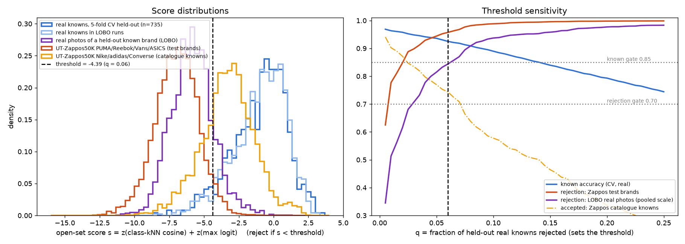

# VIETNAM: "That isn't my shoe!" (open-set sneaker brand recognition)

Label each sneaker photo as `adidas`, `converse`, `nike`, or reject it as `unknown`. The gates are:
known accuracy ≥ 0.85 and rejection of unseen look-alike brands (Puma, Reebok, Vans, Asics) ≥ 0.70.

> The submitted `model.pt` is not in this repo, because it embeds Apple's MobileCLIP2 weights, which are under Apple's model licence. `train.py` and `export.py` rebuild it from the task data. Task data and external images are not included.

## Result in one paragraph

`model.pt` (9.03 MB, TorchScript) has two parts:
- **Backbone:** a frozen, compressed MobileCLIP2-S0 image tower, a CLIP-family encoder whose language supervision makes it brand-aware.
- **Open-set head:** fit only on the 735 provided photos. It is a logistic-regression brand classifier plus a class-conditional kNN bank. The open-set score is `s = z(mean top-10 cosine to the bank of the predicted brand) + z(max logit)`. An image is rejected when `s` is below a threshold, set so that 6% of held-out real knowns are rejected.

Proxy scores at the chosen threshold:

| Proxy | Result |
|---|---|
| Known accuracy (5-fold CV, real photos, rejection counted as an error) | 0.925 (gate 0.85, margin +0.075) |
| Rejection of real photos of a held-out known brand (leave-one-brand-out) | 0.869 (gate 0.70, margin +0.17) |
| Rejection of the true test brands, UT-Zappos50K PUMA/Reebok/Vans/ASICS (catalogue photos, n=2115) | 0.957 (margin +0.26) |

## Interface of `model.pt`

- **Loading:** `torch.jit.load(path)` or `torch.load(path, weights_only=False)` both work and give identical outputs. No Python code is needed.
- **Input:** `[B,3,H,W]` or `[3,H,W]`, `uint8` or `float`.
  - Values are divided by 255 if `max > 1.5`.
  - Any `H,W` is accepted; the image is bicubic-resized to 256 (the native data is 256×256, so nothing is resized).
  - Channels-last `[B,H,W,3]` and 1-channel inputs are also accepted.
- **Output:** `[B,4]` logits in the order `model.classes == ['adidas','converse','nike','unknown']`.
  - `out[:, :3]` are the log-softmax brand scores.
  - `out[:, 3] = max(out[:, :3]) + 20·(thr − s)`, so the 'unknown' logit is the argmax exactly when the image is rejected.
  - **A plain `argmax` over the output is the final label.**
- **Verified** on CPU (`check_model.py`) in a clean `uv venv -p 3.11` with exactly torch 2.11.0, torchvision 0.26.0, numpy 2.4.6 and Pillow 12.3.0:
  - outputs from both loaders are bit-identical;
  - uint8 and float [0,1] inputs give the same result;
  - batched and single-image `[3,H,W]` inputs agree, and other input sizes work;
  - the decisions on all 735 training photos agree 99.73% with the train-time (GPU, fp32 bank) decisions.

## Method

1. **Backbone:** `timm` `fastvit_mci0.apple_mclip2_dfndr2b`, the MobileCLIP2-S0 image tower (10.8M params after MobileOne reparameterisation). It is used frozen; its 1024-d embedding is L2-normalised, with horizontal-flip TTA.
2. **Compression to fit 10 MB** (`osr_export_lib.py`). Plain int8 for every tensor is 10.8 MB, which does not fit. A per-tensor sensitivity scan showed:
   - the transformer/ConvMLP linear weights tolerate int4 (feature cosine ≥ 0.993 each);
   - the stride-2 reparameterised downsample convs collapse at int4 (cosine 0.86, and worse for stage 3).

   So I used:
   - **Group-wise int4** (groups of 32, fp16 scales, two values packed per byte) for `mlp.fc*` and `token_mixer.qkv/proj`.
   - **Per-output-channel int8** for every other weight.
   - **fp32** for norms and biases.

   The weights are dequantised inside the traced graph. The compressed backbone is 7.79 MB, with mean feature cosine 0.94 vs fp32. The head is **fit on the compressed backbone's own features**, so what is validated is exactly what ships.
3. **Head** (`train.py`), fit only on the 735 provided images plus 4 augmented views each (random resized crop, flip, colour jitter):
   - logistic regression (C=10) over the three brands;
   - a kNN bank of 400 k-means centroids per brand, built from the real and augmented features and stored as int8 (1200×1024);
   - class-conditional kNN: the mean top-10 cosine to the bank of the predicted brand. This is the "earns its label" part, since a shoe must sit close to genuine examples of the brand it is assigned to.
   - the score `s` is the sum of the z-scored kNN similarity and the z-scored max logit (z-statistics from the training data).
4. **Threshold:** the 6% quantile of the out-of-fold (5-fold CV) scores of real knowns (`thr = −4.385`). A kNN score (bank built from the real training photos) plus a calibrated quantile is the standard OOD recipe, and LOBO shows how sensitive it is.

## Validation harness (proxies)

- **CV:** 5-fold stratified on the 735 real photos (seed 0). Known accuracy counts a rejected known as wrong.
- **LOBO:** for each brand h and each fold, the head is fit on the other two brands; the unknowns are all real photos of brand h. This mimics real-photo look-alikes with distinct logos (e.g. a held-out Nike runner looks like an adidas runner without stripes). Each run's threshold is the same quantile of its own held-out knowns.
- **UT-Zappos50K** (A. Yu and K. Grauman, "Fine-Grained Visual Comparisons with Local Learning", CVPR 2014; `ut-zap50k-images-square.zip` from vision.cs.utexas.edu). Images under *Shoes/Sneakers and Athletic Shoes/* of brands containing PUMA, Reebok, Vans, ASICS or Onitsuka (2115 images) give the **exact test brands, but in a catalogue domain** (white background, 136 px). Nike/adidas/Converse images there serve as domain-shifted knowns.
  - **The final model does not use any Zappos image for fitting**; they are validation only.
  - No external image is stored in this folder (`ext/` lives only on the GPU box and is git-ignored).
  - During the exploratory fine-tuning experiments, Zappos sneakers of *other* brands (New Balance, Saucony, Skechers, ...) were used as outlier exposure. The four test brands were never used for training anywhere.

## Threshold sensitivity (final compressed model; `head_report.json`, `figure.png`)

| q (share of real knowns rejected) | thr | CV known acc | LOBO real rejection | Zappos test-brand rejection | Zappos catalogue-known acc |
|---|---|---|---|---|---|
| 0.02 | −5.44 | 0.958 | 0.671 | 0.848 | 0.861 |
| 0.03 | −5.10 | 0.948 | 0.748 | 0.898 | 0.826 |
| 0.05 | −4.58 | 0.936 | 0.831 | 0.944 | 0.767 |
| **0.06 (chosen)** | **−4.39** | **0.925** | **0.869** | **0.957** | 0.741 |
| 0.07 | −4.19 | 0.918 | 0.893 | 0.968 | 0.707 |
| 0.08 | −3.85 | 0.909 | 0.912 | 0.981 | 0.638 |
| 0.10 | −3.59 | 0.890 | 0.931 | 0.988 | 0.577 |
| 0.15 | −3.07 | 0.839 | 0.967 | 0.996 | 0.464 |

CV closed-set accuracy (no rejection) is 0.974. **Why q = 0.06:** both gates hold for q between about 0.03 and 0.12, and q = 0.06 balances the margins. The known-accuracy estimate is tight, because the test knowns should come from the same distribution as the training photos. The rejection estimate is the more uncertain one, because real-photo look-alikes may be harder than our proxies. So I accept about 0.07 less known accuracy (0.925 vs ~0.97 closed-set) to buy LOBO rejection 0.87 and test-brand rejection 0.96.



## What was tried (all proxies computed as above; scripts in `experiments/`)

| # | Approach | Known acc (CV, real) | Rejection proxies | Verdict |
|---|---|---|---|---|
| 1 | Frozen small ImageNet backbones + LR (EffNet-B0, MobileNetV3-L, RegNetY-1.6GF, ViT-Ti, EVA02-Ti, FastViT-T8, MNv4-hybrid) | 0.57–0.82 | Zappos same-domain AUROC 0.52–0.62 | weak |
| 2 | Fine-tuned EfficientNet-B0, no OE, max-softmax | 0.878 (fold 0) | Zappos test brands rejected only 4–12% at q ≤ 0.10 | fails rejection |
| 3 | + uniform-target OE (Zappos other brands) | 0.891 | Zappos rejection 0.56 at q = 0.05 | weak |
| 4 | + explicit 4th "unknown" class OE, Zappos composited onto blurred real backgrounds | 0.89 (MNv3: 0.91, B2: 0.84) | Zappos rejection 0.97–0.99, **but LOBO real-photo AUROC 0.71** (only 29–33% of real held-out Nike rejected) | learned "catalogue look = unknown", a domain shortcut |
| 5 | + CAM-erased real photos as outliers (blur out the logo / stripes / star patch the classifier relies on) | ~0.88 | LOBO AUROC 0.725 | no real gain |
| 6 | + domain-neutralising augmentations (random down/up-sampling, compositing real white-background knowns too, pairs, perspective) | ~0.90 | LOBO AUROC 0.76, rejection 0.47 at q = 0.10 | still far |
| 7 | Frozen-encoder LOBO kNN AUROC (adidas / converse / nike held out): EffNet-B0 0.62/0.57/0.62; DINOv2-S 0.65/0.58/0.61; **CLIP ViT-B/16 0.945/0.928/0.974**; MobileCLIP-S0 0.885/0.944/0.942; **MobileCLIP2-S0 0.951/0.963/0.974** | linear probe: B0 0.80, DINOv2 0.84, CLIP 0.97, MobileCLIP2 0.98 | n/a | brand knowledge comes from language supervision |
| 8 | Heads on frozen MobileCLIP2-S0 fp32 features (LOBO AUROC): MSP 0.903, prototype cosine 0.940, kNN 0.968, class-kNN 0.972, tied-cov Mahalanobis (Ledoit-Wolf, 128-d PCA) 0.966, class-kNN + Mahalanobis 0.976, **class-kNN + max-logit 0.980**; a 4-way OE head rejects every Zappos image (domain) | 0.981 | at q = 0.05: LOBO 0.91, Zappos test brands 0.998 | chosen design |
| 9 | Variants: PCA-256 bank (LOBO 0.85 → 0.68 at q = 0.05: OOD signal lives in low-variance directions); adding Zappos knowns to the head (Zappos test-brand rejection 0.998 → 0.68); bank without augmentations (0.91 → 0.85); k-means-400/class bank ≈ real + 2 aug views | | | full-dimension, real-only, k-means bank |
| 10 | Compression: all int8 = 10.8 MB (does not fit); int4 everywhere large = cosine 0.83 (downsample convs break); **int4 MLP/attention + int8 rest = 7.8 MB**, cosine 0.94; fp16 rest = 9.3 MB, no better downstream | 0.974 | at q = 0.06: LOBO 0.869, Zappos 0.957 | shipped |

## Files

- `model.pt`: the submission (9,032,924 bytes).
- `train.py`: head fitting, CV, LOBO, Zappos proxies and the threshold sweep. It runs on the GPU box; seeds are fixed and a rerun is bit-identical. It writes `head.npz`, `head_report.json`, `head_scores.npz` and `head_ref_decisions.npy`.
- `export.py`:
  - `export.py backbone` builds the compressed traced backbone (needs `timm==1.0.31` at export time only);
  - `export.py final` wraps backbone + head into `model.pt`.

  Run under the pinned torch 2.11.
- `osr_export_lib.py`: weight compression and tracing.
- `check_model.py`: load-and-predict test with both loaders, interface variants, and agreement with the train-time decisions.
- `make_figure.py` → `figure.png`.
- `experiments/`: everything from the "what was tried" table (fine-tuning with OE / CAM-erasure / domain augmentations, frozen-encoder screens, head variants, quantisation sensitivity, Zappos index).

Reproduce:

```
python export.py backbone --out backbone.pt
python train.py --backbone backbone.pt --out head.npz --q 0.06    # GPU box
python export.py final --backbone backbone.pt --head head.npz --out model.pt
python check_model.py model.pt data head_ref_decisions.npy
```

## Risks and assumptions

- **Interface:** I assumed the platform feeds RGB images as `[B,3,H,W]` (uint8 or float) and takes `argmax` over the 4 outputs in the order given by `model.classes`. Other layouts are handled defensively, but a platform that applies its own ImageNet normalisation before calling the model would shift the inputs. The model expects un-normalised [0,1] or [0,255] pixels.
- **Domain:** catalogue-style knowns (white background, low resolution, side view, as in Zappos) are rejected much more often (Zappos-known accuracy 0.74 at the chosen threshold). If the hidden knowns look like that rather than like the provided photos, known accuracy would drop.
- **Proxy validity:** neither LOBO (a whole known brand held out) nor Zappos (true test brands in a catalogue domain) is the real test distribution. Both agree, and both clear the 0.70 gate with margin across thresholds from q = 0.03 upward.
- **Pretrained weights:** MobileCLIP2 weights come from Apple via the timm Hugging Face hub (`timm/fastvit_mci0.apple_mclip2_dfndr2b`), under Apple's model licence. They are embedded (compressed) in `model.pt`.
- **Possible improvement not done:** quantisation-aware self-distillation of the int4 layers would likely recover the fp32-feature proxies (LOBO 0.89–0.91 at q = 0.05–0.06).
